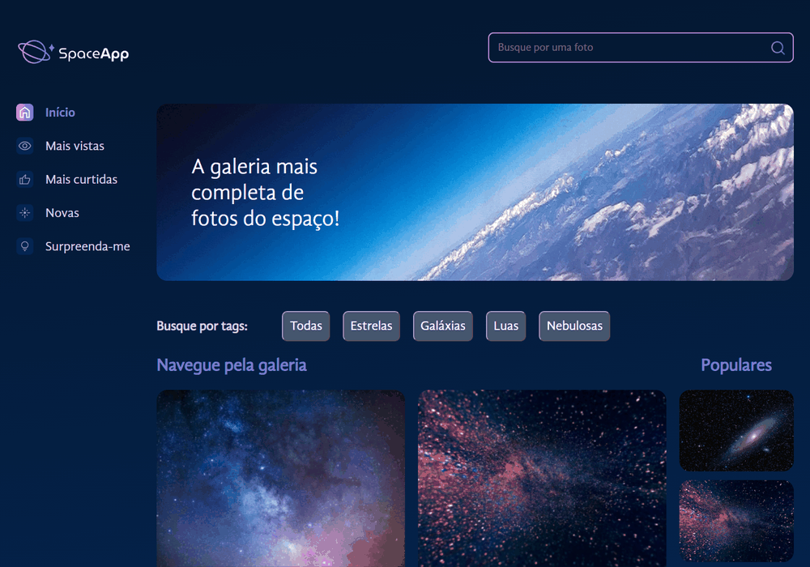

# Alura Space

Galeria de fotos do espaço desenvolvida com React, Vite e styled-components a partir do curso da Alura, com funcionalidades complementadas após as aulas.

## Demonstração



GIF capturado na aplicação real, mostrando a galeria, tags, busca, favoritos, ordenação e o botão Ver mais.

## Funcionalidades

- Busca pelo título enquanto você digita, ignorando maiúsculas, acentos e espaços nas extremidades.
- Filtros por Estrelas, Galáxias, Luas e Nebulosas, combinados com a busca.
- Favoritar e desfavoritar fotos, inclusive na visualização ampliada.
- Zoom das imagens e sorteio de uma foto com **Surpreenda-me**, respeitando os filtros.
- **Início** restaura a ordem original e limpa os filtros.
- **Mais vistas**, **Mais curtidas** e **Novas** ordenam por visualizações, curtidas e data de publicação.
- Coluna **Populares** com as cinco fotos mais vistas; **Ver mais** limpa os filtros e leva à galeria completa ordenada por visualizações.
- Mensagem quando a busca não encontra resultados e destaque da opção selecionada.

As contagens e datas iniciais são demonstrativas. Abrir uma foto incrementa suas visualizações; favoritar altera suas curtidas. As alterações ficam em memória e são reiniciadas ao recarregar a página. Não há backend nem autenticação.

## Tecnologias

- React 18 e React DOM.
- Vite 4.
- styled-components 6.
- JavaScript, JSX e dados locais em JSON.

## Como executar

Instale o Node.js com npm. Em seguida, na pasta do projeto:

```bash
npm ci
npm run dev
```

Abra o endereço informado pelo Vite no terminal, normalmente `http://localhost:5173`.

## Build de produção

```bash
npm run build
npm run preview
```

O build gera os arquivos estáticos em `dist/`. Use o endereço informado pelo comando de preview para conferir o resultado. Para publicar, envie o conteúdo de `dist/` a um serviço de hospedagem de sites estáticos.

## Organização

```text
src/
  App.jsx                 # Estados, eventos, busca e navegação
  ordenarFotos.js         # Ordenação da galeria
  fotos.json              # Fotos e dados demonstrativos
  componentes/
    BarraLateral/         # Navegação
    Cabecalho/            # Campo de busca
    Galeria/              # Fotos, tags e populares
    ModalZoom/            # Visualização ampliada
public/
  imagens/                # Imagens públicas
  icones/                 # Ícones da interface
docs/
  demo.gif                # Demonstração animada
```

## Variáveis de ambiente

O projeto atual não utiliza variáveis de ambiente nem credenciais. A revisão do código e das configurações não encontrou chaves de API, senhas ou tokens a extrair. Portanto, não é necessário criar um `.env` para executar a aplicação.

Arquivos `.env` e suas variantes estão ignorados pelo Git. Caso sejam adicionadas configurações futuramente, um `.env.example` pode documentar os nomes com valores fictícios.

No Vite, variáveis com prefixo `VITE_` usadas no frontend ficam disponíveis no navegador: mover um segredo para esse tipo de variável não o protege. Credenciais privadas devem ficar em um backend.

## Créditos

Projeto educacional baseado no Alura Space, com layout e imagens fornecidos nas aulas da Alura.
